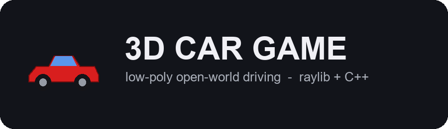

<p align="center"></p>

An open-world low-poly driving game in C++ with [raylib](https://www.raylib.com).
Nearly everything you see is generated at runtime from code — the terrain,
the road circuit, the fences, the scenery scatter and every car body except
the 3 optional "Ultra Graphics" licensed models (see Credits).

Started targeting low-end hardware (Intel HD 4000 class); that constraint was
later dropped in favor of a fuller rendering feature set — see `TODO.md` for
exactly what's still open there.

## Download

Prebuilt Windows installer (game + standalone Map Editor, both with Start
Menu/Desktop shortcuts): see [Releases](../../releases). Or build from
source below.

## Building

Requires CMake and a C++17 compiler. raylib 5.5 is fetched automatically.

```bash
cmake -S . -B build
cmake --build build --config Release
```

On Windows the CMake bundled with Visual Studio 2022 works without installing
CMake separately:

```bash
"C:\Program Files\Microsoft Visual Studio\2022\Enterprise\Common7\IDE\CommonExtensions\Microsoft\CMake\CMake\bin\cmake.exe" --build build --config Release
```

The executable lands in `build/Release/CarGame3D.exe`. Run it from that
directory so it can find `shaders/`.

## Controls

| Key | Action |
| --- | --- |
| W / A / S / D | Drive (all rebindable in Settings) |
| Space | Handbrake |
| Backspace | Respawn at the start line |
| Left Shift / Left Ctrl | Gear up / gear down (manual gearbox only; rebindable) |
| C | Cycle camera: Chase, Hood, Bumper, Orbit, Cinematic |
| P or ESC | Pause |
| M | From the pause screen, back to the main menu |
| F1 | Toggle the stats readout |

Key bindings are saved to disk and survive a restart.

## Menus

- **Drive** — start or resume driving.
- **Garage** — pick one of three cars. Changing the selection reloads the car
  and respawns you at the start line.
- **Settings** — four tabs so it stays tidy:
  - **Keybinds** — rebind any action (click a key, then press the new one),
    including gear up / gear down.
  - **Sound** — sound on/off, master / engine / effects volume sliders,
    gear-shift sound on/off, and a test button.
  - **Car** — info for the selected car, km/h or mph, world style.
  - **Gear** — Automatic or Manual gearbox and whether the gear shows on the HUD.
  Options are saved to `options.cfg`, key bindings to `settings.cfg`.
- **Credits** — third-party credits and licences.

## The cars

Three original silhouettes, generated procedurally rather than modelled:

| Name | Flavour |
| --- | --- |
| Stormfront GT | Wide-body sports sedan |
| Nightrunner RZ | Long-nose turbo coupe |
| Duneblade X | Square-shoulder JDM GT |

Each is described by a `carbody::Design` struct — lengths, tapers, rake
angles, ride height — which `CarBody.cpp` lofts into a shell by connecting a
chain of rounded cross-sections. Tweaking a car is editing numbers in
`CarDatabase.cpp`, not re-exporting a mesh.

## Source layout

One system per translation unit:

| File | Responsibility |
| --- | --- |
| `main.cpp` | Window, main loop, HUD |
| `Config.hpp` | World-scale constants in one place |
| `Terrain.cpp` | Heightfield, including the mountain ring |
| `Road.cpp` | Catmull-Rom circuit, draped onto the terrain |
| `Fence.cpp` | Roadside fencing and its collision |
| `Water.cpp` | Animated lake surface |
| `World.cpp` | Scattered props (trees, rocks) and tree collision |
| `Car.cpp` | Vehicle physics and collision response |
| `CarBody.cpp` | Procedural body and wheel meshes |
| `CarDatabase.cpp` | The three car specs |
| `Camera.cpp` | Five camera modes |
| `Menu.cpp` | Main menu, garage, settings, credits, pause |
| `Input.cpp` | Rebindable key map, persisted |
| `Lighting.cpp` | Shader loading, sky colours, fog |
| `MeshBuilder.cpp` | Batches small pieces into one mesh |

## Credits

- **raylib** — raysan5 and contributors, zlib licence.
- **Kenney Nature Kit** — kenney.nl, CC0 1.0.
- "BMW Modified Racing Car \| BMW M3 E30" by DevPoly3D — skfb.ly/pFIqo — CC BY 4.0
- "BMW M3 Competition" by VTX — skfb.ly/pMrWu — CC BY-NC-SA 4.0 (non-commercial)
- "BMW S1000 RR" by VTX — skfb.ly/pMyBS — CC BY-NC-SA 4.0 (non-commercial)
- "Oak trees pack" by LOLIPOP — skfb.ly/pNwKz — CC BY 4.0
- "Water Animation" by Artise1 — skfb.ly/6WSTs — CC BY 4.0
- Everything else (every other car body, terrain, road, fence, UI, and the
  from-scratch audio synthesizer): original to this project.

Also listed in-game under **Credits**. See `LICENSE` for how this project's
own MIT license interacts with the third-party assets above (the two
NonCommercial-licensed models in particular).

## Gearbox

Every car has a real gearbox with a single reverse (brake from a standstill):
everyday cars have **5** forward gears, sports cars **7**, the hypercar **8**.
In **Automatic** it shifts up near the redline and down as you slow. In
**Manual** you shift with the gear keys: a tall gear at low speed pulls weakly,
a low gear at speed hits the rev limiter, and a downshift that would over-rev
is refused. The engine note follows the gearbox (it drops on each upshift) and
there is a gear clunk sound you can turn off in Settings > Sound.
